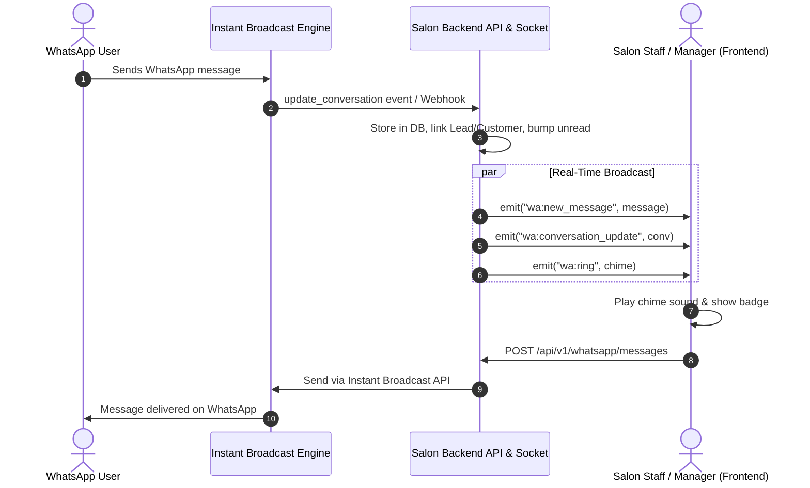

# Frontend Integration Guide: WhatsApp Chat Feature (Instant Broadcast)

This guide provides everything your frontend engineering team needs to implement the real-time WhatsApp Chat feature in the Glox Salon Management System dashboard (React, Vue, Next.js, or Angular).

---

## 1. System Architecture Overview



The frontend interacts with the system using two channels:
1. **WebSocket Connection (`socket.io-client`)**: For real-time updates (new messages, unread badges, conversation reordering, and chime sound alerts).
2. **REST API (HTTP)**: For fetching conversation history, sending messages/templates, saving internal notes, and marking chats as read.

---

## 2. Setting Up Real-Time WebSocket (`socket.io-client`)

### 2.1 Installation
```bash
npm install socket.io-client
```

### 2.2 Socket Connection Setup
Connect to the backend Socket.IO server by passing your user's JWT access token in the handshake auth:

```typescript
// src/services/socket.ts
import { io, Socket } from 'socket.io-client';

const BACKEND_URL = process.env.NEXT_PUBLIC_API_URL || 'http://localhost:4000';

let socket: Socket | null = null;

export function getChatSocket(token: string): Socket {
  if (socket && socket.connected) {
    return socket;
  }

  socket = io(BACKEND_URL, {
    auth: { token },
    query: { token },
    transports: ['websocket', 'polling'],
    reconnection: true,
    reconnectionAttempts: 10,
    reconnectionDelay: 1000,
  });

  socket.on('connect', () => {
    console.log('✅ Connected to Salon Real-Time Gateway:', socket?.id);
  });

  socket.on('connect_error', (err) => {
    console.error('❌ Socket connection error:', err.message);
  });

  return socket;
}

export function disconnectChatSocket() {
  if (socket) {
    socket.disconnect();
    socket = null;
  }
}
```

---

## 3. Real-Time Socket Events Reference

| Event Name | Payload | What Frontend Should Do |
| :--- | :--- | :--- |
| `wa:new_message` | `{ conversationId, message }` | Append message to current chat stream if open; update message preview in sidebar. |
| `wa:conversation_update` | `{ chatId, data, numberId }` | Move conversation to the top of the chat list and update unread count. |
| `wa:chat_list_update` | `{ numberId, data }` | Sync left-hand conversation order and unread indicators. |
| `wa:ring` | `{ numberId, data }` | **Play audio chime** (`ring.mp3`) and trigger browser notification/toast for incoming message. |
| `wa:message_status` | `{ providerMessageId, status }` | Update message ticks (sent $\to$ delivered $\to$ read). |
| `wa:chat_read` | `{ conversationId }` | Clear the unread badge for this conversation. |
| `wa:chat_note_saved` | `{ conversationId, note }` | Append new internal note in the agent notes sidebar tab. |
| `wa:chat_info_update` | `{ chatId, name, profilePicUrl }` | Update the contact name and avatar. |

---

## 4. REST API Reference

All requests must include `Authorization: Bearer <JWT_TOKEN>`.

### 4.1 Fetch Conversation List
```http
GET /api/v1/whatsapp/conversations?branchId=<OPTIONAL>&unreadOnly=<BOOLEAN>&search=<SEARCH_QUERY>
```
**Response (200 OK)**:
```json
[
  {
    "_id": "664fa871...",
    "phone": "+919876543210",
    "unread": 2,
    "lastMessageAt": "2026-11-01T09:40:00.000Z",
    "lastInboundAt": "2026-11-01T09:40:00.000Z",
    "customerId": {
      "_id": "...",
      "name": "Priya Shah",
      "phone": "+919876543210"
    },
    "leadId": null,
    "notes": [
      { "note": "VIP customer, prefers stylist Asha", "createdAt": "2026-11-01T09:41:00.000Z" }
    ],
    "contactMeta": {
      "pushName": "Priya S.",
      "profilePicUrl": "https://..."
    }
  }
]
```

---

### 4.2 Fetch Message History
```http
GET /api/v1/whatsapp/messages?conversationId=<CONVERSATION_ID>&limit=50&skip=0
```
**Response (200 OK)**:
```json
[
  {
    "_id": "msg_001",
    "conversationId": "664fa871...",
    "direction": "in",
    "kind": "text",
    "text": "Hi, do you have any haircut slots for today afternoon?",
    "status": "delivered",
    "createdAt": "2026-11-01T09:40:00.000Z"
  },
  {
    "_id": "msg_002",
    "conversationId": "664fa871...",
    "direction": "out",
    "kind": "text",
    "text": "Yes Priya! We have a slot open with stylist Rahul at 3:30 PM.",
    "status": "read",
    "createdAt": "2026-11-01T09:42:00.000Z"
  }
]
```

---

### 4.3 Send Message (Text or Template)
```http
POST /api/v1/whatsapp/messages
Content-Type: application/json

{
  "conversationId": "664fa871...",
  "text": "Your appointment is booked!"
}
```

> [!IMPORTANT]
> **24-Hour Customer Care Window Rule**:
> - If the customer has replied within the last 24 hours (`lastInboundAt`), you can send free-form text.
> - If $> 24$ hours have elapsed, the API returns `422 WINDOW_CLOSED`. You must send an approved template with `templateId` and optional `variables`:

```http
POST /api/v1/whatsapp/messages
Content-Type: application/json

{
  "conversationId": "664fa871...",
  "templateId": "664fa999...",
  "variables": ["Priya", "Vesu Branch", "Nov 2", "3:30 PM"]
}
```

---

### 4.4 Mark Conversation as Read
Call this when the staff member clicks and opens a conversation:
```http
POST /api/v1/whatsapp/conversations/:id/read
```
Clears the unread count locally and syncs back to Instant Broadcast.

---

### 4.5 Save Internal Agent Note
Internal staff notes are visible to the team inside the management system without sending anything to the customer:
```http
POST /api/v1/whatsapp/conversations/:id/notes
Content-Type: application/json

{
  "note": "Prefers gentle blow dry. Allergic to ammonia products."
}
```

---

### 4.6 Fetch Approved WhatsApp Templates
Use this to populate template pickers:
```http
GET /api/v1/whatsapp/templates
```

---

## 5. React / Next.js Implementation Example

### 5.1 Reusable Audio Chime Utility
```typescript
// src/utils/sound.ts
export function playInboundChime() {
  try {
    const audio = new Audio('/sounds/message-chime.mp3');
    audio.play().catch(() => {
      // Browsers block autoplay before first user interaction
    });
  } catch (err) {
    console.warn('Audio play failed', err);
  }
}
```

### 5.2 Real-Time Chat Custom Hook (`useWhatsAppChat`)
```typescript
// src/hooks/useWhatsAppChat.ts
import { useEffect, useState } from 'react';
import { getChatSocket } from '../services/socket';

export interface Message {
  _id: string;
  conversationId: string;
  direction: 'in' | 'out';
  text?: string;
  kind: 'text' | 'template' | 'media';
  status: 'sent' | 'delivered' | 'read' | 'failed';
  createdAt: string;
}

export function useWhatsAppChat(token: string, activeConversationId?: string) {
  const [messages, setMessages] = useState<Message[]>([]);

  useEffect(() => {
    if (!token) return;
    const socket = getChatSocket(token);

    // Listen for new messages
    const handleNewMessage = (payload: { conversationId: string; message: Message }) => {
      if (payload.conversationId === activeConversationId) {
        setMessages((prev) => [...prev, payload.message]);
      }
    };

    // Listen for chime alerts
    const handleRing = () => {
      // Play chime sound
      const audio = new Audio('/sounds/message-chime.mp3');
      audio.play().catch(() => {});
    };

    // Listen for delivery status ticks
    const handleStatusUpdate = ({ providerMessageId, status }: { providerMessageId: string; status: any }) => {
      setMessages((prev) =>
        prev.map((m) => (m._id === providerMessageId ? { ...m, status } : m))
      );
    };

    socket.on('wa:new_message', handleNewMessage);
    socket.on('wa:ring', handleRing);
    socket.on('wa:message_status', handleStatusUpdate);

    return () => {
      socket.off('wa:new_message', handleNewMessage);
      socket.off('wa:ring', handleRing);
      socket.off('wa:message_status', handleStatusUpdate);
    };
  }, [token, activeConversationId]);

  return { messages, setMessages };
}
```

---

## 6. Recommended 3-Pane UI Layout

```
+----------------------------------------------------------------------------------------------------+
|  Glox Salon Management System  -  WhatsApp Inbox                                                   |
+------------------------------+------------------------------------+--------------------------------+
|  Conversations (Left)        |  Chat Area (Center)                |  Customer Details (Right)      |
+------------------------------+------------------------------------+--------------------------------+
|  [🔍 Search Phone/Name]      |  Priya Shah (+91 9876543210)       |  Name: Priya Shah              |
|                              |  --------------------------------  |  Phone: +91 9876543210         |
|  * Priya Shah          (2)   |  [Inbound] Hi, can I book for 4pm? |  Visits: 14 | Spend: ₹18,400   |
|    "Hi, can I book for 4pm?" |                                    |  ----------------------------  |
|    09:40 AM                  |  [Outbound] Sure! We have a slot.  |  Internal Notes:               |
|                              |  [Delivered ✓✓]                    |  - Prefers ammonia-free dye    |
|  * Rahul V.            (0)   |                                    |  [+ Add Note]                  |
|    "Thanks for the bill!"    |  --------------------------------  |  ----------------------------  |
|    Yesterday                 |  ⚠️ 24h Window Closes in 18 hrs    |  Recent Bills:                 |
|                              |  --------------------------------  |  - Haircut & Spa (₹1,500)      |
|  * Lead: +91 9811100000 (1)  |  [Type a message...   ] [Templates] |  Rating: ⭐⭐⭐⭐⭐             |
|    "Price for Keratin?"      |  [Send Button]                     |  [Convert to Appointment]      |
+------------------------------+------------------------------------+--------------------------------+
```

### Key UI Features to Include:
1. **Unread Counter Badge**: Show blue/green pill with `unread` count on conversation list items.
2. **24-Hour Indicator Banner**:
   - Calculate remaining time: `24 * 3600 * 1000 - (Date.now() - new Date(lastInboundAt).getTime())`.
   - If positive, display "24-Hour Free-form Window Active".
   - If expired, disable the free-form text input and present a "Select Template" dropdown.
3. **Sound Chime Setting**: Include a toggle in your dashboard navbar (`Mute/Unmute Notifications`) that controls whether the `wa:ring` event plays audio.
4. **Quick Actions**: Provide a 1-click button in the right-side customer card to **"Book Appointment"** or **"Convert Lead to Customer"**.

